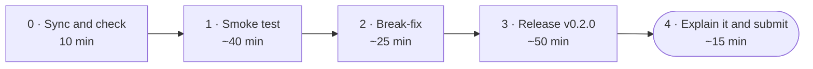

# Lab 6 · Mission: test what you ship, ship a release

**Make your pipeline start the image before it pushes it, watch it catch a broken image that every test missed, and ship `v0.2.0` from a tag. This brief says what must be true in your fork. Finding out how is the mission.**

DevOps (ELE1013M) · Turiba University · Session 6 · a short intro, then this mission at your own pace · individual work
Theory: Session 6 slides "Continuous Integration II: test what you ship, ship a release" (BATIS), slides 8–12

| | |
|-|-|
| **You will** | Add a smoke test to your `image` job; find and fix a fault that only shows up in the image; write a release workflow and ship `v0.2.0` with it |
| **You hand in** | The URL of your fork on Evaluentis: `https://github.com/<you>/turiba-devops-labs` |
| **Passed when** | The gates G1–G6 (80 points), plus the quality of your write-up, PRs and commits (20 points). A script reads your fork through the GitHub API and pulls your image without logging in. Nothing of yours runs on the grader's machine. An LLM reads your write-up |
| **Deadline** | **Tue 3 Nov 2026, 22:00** (Riga). A snapshot of your fork is taken at 22:05 |



---

## How this mission works

From this session on, a lab is a **mission**. It tells you what must be true when you're done, and where to learn how. It doesn't give you the commands. You learn by reading the docs, trying, reading the error, and trying again. That's the job.

| Part | Typical time | Theory slides |
|------|-------------:|--------------:|
| 0 · Sync and check | 10 min | 2 |
| 1 · Smoke test | 40 min | 8–10 |
| 2 · Break-fix | 25 min | 9–11 |
| 3 · Release v0.2.0 | 50 min | 12 |
| 4 · Explain it and submit | 15 min | — |

- Do the parts **in order**. Part 2 needs the smoke test from Part 1.
- **Hints are free:** 🔎 **Look** (where to look) → 💡 **Think** (the idea) → 🛠 **Fix** (the answer). Open one level at a time. Stuck for more than 10 minutes? Open the next hint, check the troubleshooting table, then raise your hand.
- **`bash lab06-test-and-release/check.sh`** shows what the grader will see, gate by gate. Run it whenever you like.
- **📝** marks something you write into `lab6/README.md`. **🔮** marks a prediction: write it **before** you look. A wrong prediction that you explain earns full marks.
- Commands are written for **bash**: on Windows, use the **Ubuntu (WSL)** terminal in `~/turiba-devops-labs`.

> ⚠️ **Five rules for your fork in this mission**
> 1. **Every change reaches `main` through a pull request in your fork.** Check the base repository of every PR: **`<you>/turiba-devops-labs`**, never the course repo.
> 2. **Keep the job names** `lint`, `unit`, `integration` and `image`. They are your required checks.
> 3. **Your smoke test goes in the `image` job**, in a step whose **name contains `smoke`**. That's how the grader finds it.
> 4. **The release is made by your workflow, never by hand** in the GitHub web page.
> 5. **Never put a password or token in a file.**

---

## Finish line: the gates

| Gate | Points | What must be true at the snapshot |
|------|-------:|-----------------------------------|
| **G1** · The Lab 6 sync PR is merged | 5 | `lab06-test-and-release/` is on your `main`, unchanged |
| **G2** · Your image job smoke-tests the image before pushing it | 20 | The newest `ci` run on `main` is green. Its `image` job has a step with `smoke` in its name that passed, and it runs before every step with `push` in its name. `image` is still a required check on `main` |
| **G3** · Break-fix: a merged PR with a red smoke test, then all four checks green | 20 | A merged PR into `main` contains the `break.sh` commit. On an earlier commit of that PR, `image` failed **in the smoke step** while `lint`, `unit` and `integration` were green. On its last commit, all four are green. It was merged after that |
| **G4** · Release v0.2.0: the tag, a Release made by the workflow, api:0.2.0 for amd64 and arm64 | 25 | The tag `v0.2.0` is on GitHub, and a workflow run for it succeeded. The GitHub Release `v0.2.0` was made by `github-actions[bot]`, with generated notes. `ghcr.io/<you>/turiba-devops-labs/api:0.2.0` can be pulled without logging in, for `linux/amd64` and `linux/arm64` |
| **G5** · No password or token in the repository | 5 | Checked by the grader over all branches and tags |
| **G6** · lab6/README.md: "What broke and how I found it" | 5 | Section 2 of `lab6/README.md` names the check and step that went red, quotes the log line that showed the cause, explains the cause, and says why the tests stayed green |

The other **20 points** are for quality:

| Criterion | Points | What earns them |
|-----------|-------:|-----------------|
| Q1 | 8 | Your explanation in section 2 is in your own words, with your own log line, and the cause chain is right |
| Q2 | 6 | Your PR descriptions say what was changed and what the checks showed |
| Q3 | 6 | Conventional Commit messages (`ci:`, `fix:`, `docs:` …), about one per step |

---

## Learn from

| For | Read or watch | What to take from it |
|-----|---------------|----------------------|
| Part 1 | Docker Docs, [Test before push with GitHub Actions](https://docs.docker.com/build/ci/github-actions/test-before-push/) | The whole pattern: build with `load: true`, test, then build and push. Read the note under the example about building only once |
| Part 1 | Docker Docs, [Export to Docker](https://docs.docker.com/build/ci/github-actions/export-docker/) | What `load: true` does, and why it takes one platform |
| Part 3 | GitHub Docs, [Publishing Docker images](https://docs.github.com/en/actions/tutorials/publish-packages/publish-docker-images) | A complete publish workflow for GHCR, with the permissions it needs |
| Part 3 | GitHub Docs, [Workflow syntax](https://docs.github.com/en/actions/reference/workflows-and-actions/workflow-syntax), section `on.push.<branches\|tags…>` | How to run a workflow when a tag is pushed |
| Part 3 | [`docker/metadata-action`](https://github.com/docker/metadata-action), section `type=semver` | How tag `v0.2.0` becomes image tag `0.2.0` |
| Part 3 | GitHub Docs, [Automatically generated release notes](https://docs.github.com/en/repositories/releasing-projects-on-github/automatically-generated-release-notes), and the [`gh release create`](https://cli.github.com/manual/gh_release_create) manual (`--generate-notes`) | How a workflow creates the Release and its notes |
| Video | Brian Morrison, [Push Docker Images to GitHub Container Registry](https://www.youtube.com/watch?v=RgZyX-e6W9E) (2023, 15 min) | GHCR by hand, then from Actions |
| Video | Pytalista, [How to use tags to create a release in GitHub with Actions](https://www.youtube.com/watch?v=_3jhTZF43vY) (2024, 15 min) | Tags vs commits, and `gh release create --generate-notes` in a workflow |
| Hands-on, optional | GitHub Skills, [Publish Docker Images](https://github.com/skills/publish-docker-images) | A guided exercise in its own repo, under an hour |

---

## Part 0 · Sync and check (10 min)

**1. Bring the Lab 6 material into your fork** through a pull request, the same way as in Labs 4 and 5:

```bash
git switch main && git pull
git fetch upstream
git switch -c chore/sync-upstream
git merge upstream/main
git push -u origin HEAD
```

Open the PR in **your fork**, merge it with **Create a merge commit**, then run `git switch main && git pull`.

**2. Check that your Lab 5 pipeline is green.** Open your fork's **Actions** tab. The newest `ci` run on `main` must be green, and `lint`, `unit`, `integration` and `image` must still be required checks in your ruleset `protect-main`.

> **Lab 5 isn't green?** Copy the reference pipeline. It costs no points:
> `cp lab06-test-and-release/reference/ci.yml .github/workflows/ci.yml`
> It still needs the rest of Lab 5: the `DB_PASSWORD` secret, `api/eslint.config.js`, the npm scripts and the four required checks. Bring it in through a PR, like every change.

**3. Start your write-up:**

```bash
mkdir -p lab6 && cp lab06-test-and-release/write-up-template.md lab6/README.md
```

✅ **Checkpoint:** `ls lab06-test-and-release` shows `break.sh`, `check.sh`, `check.py`, `reference/` and `write-up-template.md`. Your newest `ci` run on `main` is green.

---

## Part 1 · Smoke test (40 min)

**What must be true:** on every PR and on every push to `main`, the `image` job does three things before anything is pushed:

1. It builds the image for the runner and keeps it in the runner's `docker images`.
2. It starts the image and asks `GET /`.
3. If there's no answer, it prints the container's log and fails.

On `main`, the existing step then pushes the image for both platforms, as in Lab 5.

- `GET /` answers without a database, so the smoke test needs no PostgreSQL.
- At least one of your new steps has **`smoke`** in its name.
- Make the change on a branch, through a PR. The PR's `image` check must be green before you merge.

🔮 **Predict** (📝 section 1): will your current code pass the smoke test the first time? If not, what will fail?

<details><summary>🔎 Look</summary>

Docker's "Test before push" page (above) is almost exactly this. Compare its two `build-push-action` steps with the one in your `image` job.
</details>

<details><summary>💡 Think</summary>

`load: true` puts the image into the runner's local Docker, so `docker run` can start it, but it works for **one** platform only. So the test build has no `platforms:` line. Your existing multi-platform push step stays after it, unchanged. It reuses the cached layers, so the amd64 image is built only once (slide 10). A container needs a second to start, so let `curl` retry. Slide 10 has the shape.
</details>

<details><summary>🛠 Fix</summary>

Insert these two steps into the `image` job, just before `Build, and push from main only`:

```yaml
      - name: Build for the smoke test (amd64, kept on the runner)
        uses: docker/build-push-action@v7
        with:
          context: api
          load: true
          tags: ${{ env.IMAGE }}:${{ github.sha }}
      - name: Smoke test the image
        run: |
          docker run -d --name smoke -p 5000:5000 "$IMAGE:${{ github.sha }}"
          if ! curl --silent --show-error --fail --retry 10 --retry-delay 1 --retry-all-errors http://localhost:5000/; then
            echo "::error::The image did not answer GET /. Its log:"
            docker logs smoke
            exit 1
          fi
```
</details>

✅ **Checkpoint:** on your PR, open the `image` job. The smoke step ran, and `curl` printed `{"name":"course-api","version":"…"}`. After the merge, the `ci` run on `main` is green, and in its `image` job the smoke step comes before `Build, and push from main only`.

📝 Section 1: your step names, what your smoke test asks, and what makes it fail.

---

## Part 2 · Break-fix (25 min)

A teammate has a small feature ready: a startup banner. `break.sh` brings their commit into your clone on a new branch:

```bash
git switch main && git pull
bash lab06-test-and-release/break.sh
git push -u origin HEAD
```

Open a PR into `main` in **your fork**.

🔮 **Predict** before the checks finish (📝 section 1): which of `lint`, `unit`, `integration` and `image` will go red?

**What must be true:** you find the cause in the log, fix it **on the same branch**, and merge when all four checks are green. Keep the banner: the fix makes the image contain what the code needs. Don't revert the teammate's feature.

<details><summary>🔎 Look</summary>

Open the red check, then the failed step, and read the container log your smoke step printed. Which file is missing? Then look at the three files the commit changed (**Files changed** tab of the PR).
</details>

<details><summary>💡 Think</summary>

`lint`, `unit` and `integration` run your **source code** on the runner, where every file exists. The image only gets what the build context and your Dockerfile give it. Something that excludes a file from the context, or a `COPY` that lists files by name, leaves the image without it (slides 9 and 10).
</details>

<details><summary>🛠 Fix</summary>

The commit added `banner.js` to `api/.dockerignore`. Delete those two lines, commit (`fix(api): keep banner.js in the image`) and push. If your Dockerfile copies files by name (`COPY server.js db.js validate.js ./`), add `banner.js` to that line too.
</details>

✅ **Checkpoint:** the PR's first commit has a red `image` check, red in the **smoke** step, with `lint`, `unit` and `integration` green. Its last commit has all four green, and the PR is merged.

📝 Section 2, **"What broke and how I found it":** the check and the step that went red, the log line that showed the cause (copied), the cause in your own words, why the other three stayed green, and your fix.

---

## Part 3 · Release v0.2.0 (50 min)

**What must be true:** a new workflow, `.github/workflows/release.yml`, runs when a tag that starts with `v` is pushed, and does four things:

1. It builds the image for **`linux/amd64` and `linux/arm64`**.
2. It pushes it as `ghcr.io/<you>/turiba-devops-labs/api:0.2.0`. The version has no `v`, and other tags such as `latest` are allowed as well.
3. It creates the GitHub Release `v0.2.0` with **generated notes**.
4. It asks only for the permissions it needs, on its own job: `contents: write` for the Release and `packages: write` for the image.

- `release.yml` reaches `main` through a PR **before** you push the tag. A tag runs the workflows that exist in the tagged commit.
- Then tag `main` and push the tag:

```bash
git switch main && git pull
git tag v0.2.0
git push origin v0.2.0
```

- **If the release run fails** before it publishes anything, fix `release.yml` through a PR, then move the tag. That's allowed only because nothing was released yet:

```bash
git push --delete origin v0.2.0 && git tag -d v0.2.0     # then tag and push again, as above
```

Once a Release exists, a tag never moves (slide 12).

<details><summary>🔎 Look</summary>

GitHub's "Publishing Docker images" page has a whole publish workflow. Your Lab 5 `image` job already has most of it: the lowercase image name, QEMU, Buildx, the GHCR login and the multi-platform build.
</details>

<details><summary>💡 Think</summary>

Three new things:

- **The trigger:** `on: push: tags:` with a pattern.
- **The image tag:** `docker/metadata-action` turns the Git tag into `0.2.0`. Use its output as the `tags` of `build-push-action`.
- **The Release:** `gh` is installed on every runner, and it needs a token in `GH_TOKEN` and `contents: write`.
</details>

<details><summary>🛠 Fix</summary>

```yaml
name: release

on:
  push:
    tags: ['v*']

permissions:
  contents: read

jobs:
  release:
    runs-on: ubuntu-24.04
    timeout-minutes: 20
    permissions:
      contents: write
      packages: write
    steps:
      - uses: actions/checkout@v7
      - name: Image name in lowercase
        run: echo "IMAGE=ghcr.io/${GITHUB_REPOSITORY,,}/api" >> "$GITHUB_ENV"
      - name: Image tags from the Git tag
        id: meta
        uses: docker/metadata-action@v6
        with:
          images: ${{ env.IMAGE }}
          tags: type=semver,pattern={{version}}
      - uses: docker/setup-qemu-action@v4
      - uses: docker/setup-buildx-action@v4
      - uses: docker/login-action@v4
        with:
          registry: ghcr.io
          username: ${{ github.actor }}
          password: ${{ secrets.GITHUB_TOKEN }}
      - name: Build and push the release image
        uses: docker/build-push-action@v7
        with:
          context: api
          platforms: linux/amd64,linux/arm64
          push: true
          tags: ${{ steps.meta.outputs.tags }}
          labels: ${{ steps.meta.outputs.labels }}
      - name: Create the GitHub Release
        env:
          GH_TOKEN: ${{ github.token }}
        run: gh release create "$GITHUB_REF_NAME" --generate-notes --verify-tag
```
</details>

✅ **Checkpoint:**

- The Actions tab has a green run for `v0.2.0`.
- **Releases** shows `v0.2.0` by `github-actions` with a "What's Changed" list.
- Logged out, `docker pull ghcr.io/<you>/turiba-devops-labs/api:0.2.0` works.
- `docker buildx imagetools inspect ghcr.io/<you>/turiba-devops-labs/api:0.2.0` lists `linux/amd64` and `linux/arm64`.

📝 Section 3: the release URL, the image and its platforms.

---

## Part 4 · Explain it and submit (15 min)

1. Finish `lab6/README.md`: every `____` replaced. Bring it in through a PR, like every change.
2. Run the self-check:

   ```bash
   bash lab06-test-and-release/check.sh
   ```

   It finds a token by itself if `gh` is logged in. Otherwise it asks for a classic token (your Lab 1 token works) and hides what you paste. Without a token it still runs, but the classroom shares one address and GitHub allows 60 calls an hour without one.
3. Submit `https://github.com/<you>/turiba-devops-labs` on Evaluentis. **Submitted → you can leave.**

✅ **Checkpoint:** `check.sh` shows ✔ for G1, G2, G3, G4 and G6. G5 is checked by the grader only.

---

## Troubleshooting

| You see | Why | Fix |
|---------|-----|-----|
| The smoke build fails with an error about exporting a manifest list or multiple platforms | `load: true` with two platforms | The smoke build has no `platforms:` line: one platform, the runner's |
| `curl: (7) Failed to connect to localhost port 5000` once, then the step passes | The API needs a moment to start | That's what `--retry` is for. If every try fails, read the `docker logs` output under it |
| The smoke step fails, and `docker logs` shows `Cannot find module` | A file is missing from the image | That's Part 2's lesson: check `api/.dockerignore` and the `COPY` lines in `api/Dockerfile` |
| After your Part 2 fix, the image still crashes with `Cannot find module './banner'` | Your Dockerfile copies files by name | Add `banner.js` to that `COPY` line as well |
| `break.sh` says `✘ …` | It refuses rather than guess | Do what the line says. It changed nothing |
| You pushed the tag, and no workflow ran | `release.yml` wasn't in the tagged commit, or the pattern doesn't match `v0.2.0` | Merge `release.yml` first, then move the tag (Part 3) |
| `gh release create` fails with `HTTP 403: Resource not accessible by integration` | The job lacks `contents: write` | Add it to the release job's `permissions:` |
| The push to GHCR fails with `denied` or `write_package` | The job lacks `packages: write`, or the package isn't connected to your repository | Add the permission. For the package, run `bash lab05-ci-pipeline/ghcr-check.sh` |
| `git push` is refused: `refusing to allow … to create or update workflow … without workflow scope` | You push over HTTPS with a token that can't change workflows | Use SSH (Lab 3, Part 0) |
| Releases shows `v0.2.0` made by **you** | It was made in the web page | Delete that Release (not the tag) and re-run the release workflow's failed or finished run (**Re-run all jobs**) |
| A logged-out `docker pull … :0.2.0` says `denied` | The package is private | Lab 5, step 3.3: make the package public |
| `check.sh` says GitHub's rate limit is used up | No token, on a shared network | `gh auth login`, or paste a token when it asks |

---

## Stretch (for fast finishers)

| Goal | Proves |
|------|--------|
| **Promote, don't rebuild:** in `release.yml`, give the image that `main` already tested the tag `0.2.0` with `docker buildx imagetools create`, instead of building again. How do you find the right SHA? | Slides 10 and 12 |
| Bump `"version"` in `api/package.json` to `0.2.0` before you tag, and make the release workflow smoke-test that `GET /` says `0.2.0` | That the release *is* that version |
| Add `.github/release.yml` so that the generated notes group PRs by label | GitHub's release-notes docs |

---

## Command summary

```bash
bash lab06-test-and-release/break.sh                  # Part 2: the teammate's commit, on feat/startup-banner
git tag v0.2.0 && git push origin v0.2.0              # Part 3: release (after release.yml is on main)
docker buildx imagetools inspect ghcr.io/<you>/turiba-devops-labs/api:0.2.0   # both platforms?
bash lab06-test-and-release/check.sh                  # what the grader will see
```
