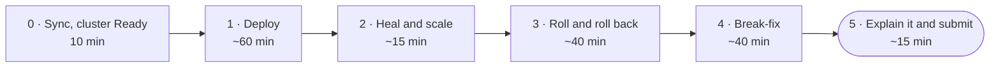

# Lab 7 · Mission: run it on a cluster

**Write the manifests that run your `api:0.2.0` on Kubernetes, watch the cluster heal and roll, then find three faults a teammate brought in. This brief says what must be true in your fork. Finding out how is the mission.**

DevOps (ELE1013M) · Turiba University · Session 7 · a short intro, then this mission at your own pace · individual work
Theory: Session 7 slides "Kubernetes I: run it on a cluster" (BATIS), slides 6–13

| | |
|-|-|
| **You will** | Write a Namespace, a Deployment and a Service; deploy your image to a local kind cluster; watch self-healing; roll a new version out and a broken one back; debug three faults with the debug loop |
| **You hand in** | The URL of your fork on Evaluentis: `https://github.com/<you>/turiba-devops-labs` |
| **Passed when** | The gates G1–G6 (80 points), plus the quality of your write-up, PRs and commits (20 points). The grader starts a **fresh** kind cluster, runs **one** `kubectl apply -f k8s/` from your `main`, and checks the rollout and `GET /`. An LLM reads your write-up |
| **Deadline** | **Tue 10 Nov 2026, 22:00** (Riga). A snapshot of your fork is taken at 22:05 |



---

## How this mission works

Like Mission 6: the brief tells you what must be true when you're done, and where to learn how. You learn by reading the docs, trying, reading the error, and trying again.

| Part | Typical time | Theory slides |
|------|-------------:|--------------:|
| 0 · Sync, cluster Ready | 10 min | 2 |
| 1 · Deploy | 60 min | 6–10 |
| 2 · Heal and scale | 15 min | 4, 7 |
| 3 · Roll and roll back | 40 min | 11–12 |
| 4 · Break-fix | 40 min | 8, 9, 13 |
| 5 · Explain it and submit | 15 min | — |

- Do the parts **in order**. Part 4 needs the working manifests from Part 1.
- **Hints are free:** 🔎 **Look** → 💡 **Think** → 🛠 **Fix**. Open one level at a time. Stuck for more than 10 minutes? Open the next hint, check the troubleshooting table, then raise your hand.
- **`bash lab07-run-it-on-a-cluster/check.sh`** does what the grader does: a throwaway cluster, one `apply`, the rollout and `GET /`. Run it whenever you like.
- **📝** marks something you write into `lab7/README.md`. **🔮** marks a prediction: write it **before** you look.
- **Always say the namespace:** `kubectl -n course …`. Or set it once: `kubectl config set-context --current --namespace=course`.
- Commands are written for **bash**: on Windows, use the **Ubuntu (WSL)** terminal in `~/turiba-devops-labs`.

> ⚠️ **Five rules for this mission**
> 1. **Every change reaches `main` through a pull request in your fork**, never in the course repo.
> 2. **Use the exact names in Part 1.** The grader and `break.sh` find your objects by them.
> 3. **Your image path is lowercase:** `ghcr.io/<you>/turiba-devops-labs/api:…`, with `<you>` in lowercase.
> 4. **`k8s/` holds a Namespace, a Deployment and a Service, nothing else.** The grader refuses to apply anything more.
> 5. **Delete your cluster when you stop for the day:** `kind delete cluster`. It uses memory while it runs. Your files are safe in Git.

---

## Finish line: the gates

| Gate | Points | What must be true at the snapshot |
|------|-------:|-----------------------------------|
| **G1** · The Lab 7 sync PR is merged | 5 | `lab07-run-it-on-a-cluster/` is on your `main`, unchanged |
| **G2** · k8s/ on main: the three files, the names, your image, the ports | 30 | `k8s/` has `00-namespace.yaml`, `api-deployment.yaml` and `api-service.yaml`, with the names and numbers from Part 1. The image is yours (or the fallback), pinned to a tag that exists, never `latest` |
| **G3** · One apply on a fresh cluster: 3 Pods ready, GET / answers through the Service | 20 | On a new kind cluster, **one** `kubectl apply -f k8s/` succeeds, the rollout finishes within 3 minutes, and `GET /` through `service/api` answers |
| **G4** · Break-fix: a merged PR with the teammate's commit and your fixes | 15 | A merged PR into `main` contains the `break.sh` commit and your own later commits that change `k8s/`. G2 passes on `main` afterwards |
| **G5** · No password or token in the repository | 5 | Checked by the grader over all branches and tags |
| **G6** · lab7/README.md: "Roll and roll back" and "What broke and how I found it" | 5 | Sections 3 and 4 of `lab7/README.md` tell the rollout story with your own output, and name each of the three faults with the command that showed it |

The other **20 points** are for quality:

| Criterion | Points | What earns them |
|-----------|-------:|-----------------|
| Q1 | 8 | Your own output, copied, and your predictions, with any mismatch explained |
| Q2 | 6 | Your PR descriptions say what changed and how you checked it on the cluster |
| Q3 | 6 | Conventional Commit messages, one fix per commit in Part 4 |

---

## Learn from

| For | Read or watch | What to take from it |
|-----|---------------|----------------------|
| Parts 0–1 | [kind quick start](https://kind.sigs.k8s.io/docs/user/quick-start/) | Creating, listing and deleting clusters; how kind sets your kubectl context |
| Part 1 | Kubernetes docs: [Deployments](https://kubernetes.io/docs/concepts/workloads/controllers/deployment/) | The first example is almost your file. Read "Creating a Deployment" |
| Part 1 | Kubernetes docs: [Service](https://kubernetes.io/docs/concepts/services-networking/service/) and [Labels and Selectors](https://kubernetes.io/docs/concepts/overview/working-with-objects/labels/) | `selector`, `port`, `targetPort`; how a Service finds Pods |
| Part 3 | Deployments page, sections "Updating a Deployment" and "Rolling Back a Deployment" | `rollout status`, `rollout history`, `rollout undo` |
| Part 4 | [Debug Pods](https://kubernetes.io/docs/tasks/debug/debug-application/debug-pods/) and [Debug Services](https://kubernetes.io/docs/tasks/debug/debug-application/debug-service/) | The questions to ask, in order |
| Always | [kubectl quick reference](https://kubernetes.io/docs/reference/kubectl/quick-reference/) | The commands you'll type all evening |
| Video | Mischa van den Burg, [Kubernetes Crash Course for Beginners](https://www.youtube.com/watch?v=9AKSLbfen6w) (2025, 20 min) | Pods, Deployments, scaling, Services and port-forward, step by step. His cluster comes from Rancher Desktop; yours from kind. The kubectl is the same |
| Video, longer | DevOps Directive, [Complete Kubernetes Course](https://www.youtube.com/watch?v=2T86xAtR6Fo) (2024) | Only the chapters "Installation and Set Up" (it uses kind) and "Built-in Kubernetes Resources" |
| Hands-on, optional | iximiuz Labs, Kubelings: [ImagePullBackOff](https://labs.iximiuz.com/courses/kubelings-dbd840c8/module-01/imagepull-backoff), [The Service that routes to nothing](https://labs.iximiuz.com/courses/kubelings-dbd840c8/module-01/selector-mismatch) (free account) | Practice reading the same kinds of fault you'll meet in Part 4 |

---

## Part 0 · Sync and check (10 min)

**1. Bring the Lab 7 material into your fork** through a pull request, the same way as in Labs 4–6:

```bash
git switch main && git pull
git fetch upstream
git switch -c chore/sync-upstream
git merge upstream/main
git push -u origin HEAD
```

Open the PR in **your fork**, merge it with **Create a merge commit**, then run `git switch main && git pull`.

**2. Your cluster:**

```bash
kind create cluster                 # skip it if `kind get clusters` already lists "kind"
kubectl config current-context      # kind-kind
kubectl get nodes                   # one node, STATUS Ready
```

No kind yet? Do "Before Lab 7" in the course README first. Your laptop can't run kind? Use a [Killercoda playground](https://killercoda.com/playgrounds) (free account, one-hour sessions), and push your files from your laptop.

**3. Start your write-up:**

```bash
mkdir -p lab7 && cp lab07-run-it-on-a-cluster/write-up-template.md lab7/README.md
```

✅ **Checkpoint:** `kubectl get nodes` shows `Ready`. `ls lab07-run-it-on-a-cluster` shows `break.sh`, `check.sh`, `check.py` and `write-up-template.md`.

---

## Part 1 · Deploy (60 min)

**What must be true:** a folder `k8s/` at the root of your repository, with exactly these objects:

| File | Object | Must have |
|------|--------|-----------|
| `k8s/00-namespace.yaml` | Namespace `course` | — |
| `k8s/api-deployment.yaml` | Deployment `api` in namespace `course` | `replicas: 3`; selector and Pod labels `app: api`; one container named `api` with your image and `containerPort: 5000` |
| `k8s/api-service.yaml` | Service `api` in namespace `course` | type `ClusterIP`; selector `app: api`; `port: 80` → `targetPort: 5000` (a number, no quotes) |

- **The image** is `ghcr.io/<you>/turiba-devops-labs/api:0.2.0`, the release from Mission 6, with `<you>` in lowercase. No `0.2.0` of your own? Use the fallback, `ghcr.io/martinsturiba/turiba-devops-labs/api:0.2.0`. It costs no points.
- **One `kubectl apply -f k8s/`** on a fresh cluster must create everything. Files are applied in name order, which is why the Namespace file starts with `00-` (slide 10).
- `kubectl -n course port-forward service/api 8080:80` (in a second terminal), then `curl -s localhost:8080/`, answers `{"name":"course-api",…}`.
- The three files reach `main` through a PR.

🔮 **Predict** (📝 section 1): after `kubectl apply -f k8s/`, how many Pods will `kubectl -n course get pods` show, and what will their names start with?

<details><summary>🔎 Look</summary>

The Deployments page in the Kubernetes docs starts with a complete Deployment for nginx. Change it, don't start from nothing. The Service page has a Service with `selector`, `port` and `targetPort`. Slide 10 shows which fields must match each other.
</details>

<details><summary>💡 Think</summary>

Three things must agree, or nothing works:

- the Deployment's `selector.matchLabels` and its Pod template's `labels`;
- the Service's `selector` and those same Pod labels (slide 8);
- the Service's `targetPort` and the port the API really listens on, 5000 (slide 9).

The image must exist and be public. You can check that with `docker buildx imagetools inspect <image>`.
</details>

<details><summary>🛠 Fix</summary>

`k8s/00-namespace.yaml`:

```yaml
apiVersion: v1
kind: Namespace
metadata:
  name: course
```

`k8s/api-deployment.yaml`:

```yaml
apiVersion: apps/v1
kind: Deployment
metadata:
  name: api
  namespace: course
spec:
  replicas: 3
  selector:
    matchLabels:
      app: api
  template:
    metadata:
      labels:
        app: api
    spec:
      containers:
        - name: api
          image: ghcr.io/<you>/turiba-devops-labs/api:0.2.0
          ports:
            - containerPort: 5000
```

`k8s/api-service.yaml`:

```yaml
apiVersion: v1
kind: Service
metadata:
  name: api
  namespace: course
spec:
  type: ClusterIP
  selector:
    app: api
  ports:
    - port: 80
      targetPort: 5000
```

Then run `kubectl apply -f k8s/` and `kubectl -n course rollout status deployment/api`.
</details>

✅ **Checkpoint:** `kubectl -n course get deploy,rs,pods` shows `3/3` ready. `curl -s localhost:8080/` answers through the port-forward. `bash lab07-run-it-on-a-cluster/check.sh` shows ✔ for G2 and G3 once the PR is merged.

📝 Section 1: the output of `kubectl -n course get deploy,rs,pods` and of the `curl`.

---

## Part 2 · Heal and scale (15 min)

**What must be true:** you have seen the cluster replace a Pod you deleted, and change the number of Pods when the YAML changed.

1. 🔮 **Predict** (📝 section 2): you delete one of the three Pods. What does `kubectl -n course get pods` show two seconds later?
2. Delete one Pod, then look. `kubectl -n course get pods -w` watches; Ctrl+C stops it.
3. In `k8s/api-deployment.yaml`, change `replicas` to `5`, apply, and look. Then set it back to `3` and apply again. **Don't commit the 5**: at the end, `git diff` is empty.

✅ **Checkpoint:** you saw a new Pod name with a few seconds' age, then 5 Pods, then 3 again.

📝 Section 2: the `get pods` output after the delete, and after the scale to 5.

---

## Part 3 · Roll and roll back (40 min)

**3a · A newer version.** Change the image tag in `k8s/api-deployment.yaml` to a newer image of yours, through a PR, then apply it and watch the rolling update finish.

- **Your newest image:** CI pushes `ghcr.io/<you>/turiba-devops-labs/api:<commit SHA>` for every commit on `main` (Lab 5). `git log -1 --format=%H origin/main` gives you the SHA of the newest one.
- **Fallback users:** roll from `0.2.0` to `ghcr.io/martinsturiba/turiba-devops-labs/api:⟨newer tag, filled in after the test run⟩`.

**3b · A broken version, and back.** On your working copy only, without committing:

1. Change the tag to `9.9.9`, which doesn't exist, and `kubectl apply -f k8s/`.
2. 🔮 **Predict** (📝 section 3): how many of the old Pods keep running?
3. Watch `kubectl -n course rollout status deployment/api --timeout=30s` and `kubectl -n course get pods`.
4. `kubectl -n course rollout undo deployment/api`, and read the warning it prints.
5. Make Git and the cluster agree again: `git restore k8s/`, then `kubectl apply -f k8s/`.

<details><summary>🔎 Look</summary>

The Deployments page, sections "Updating a Deployment", "Checking Rollout History of a Deployment" and "Rolling Back to a Previous Revision".
</details>

<details><summary>💡 Think</summary>

With 3 replicas, the defaults allow 1 extra Pod and 0 unavailable during a rolling update (slide 11). A Pod whose image can't be pulled never becomes ready, so the old ones are never removed. `rollout undo` changes the cluster but not your file in Git. That's what the warning says, and why step 5 exists (slide 12).
</details>

<details><summary>🛠 Fix</summary>

```bash
kubectl -n course rollout status deployment/api       # 3a: waits until done
kubectl -n course rollout history deployment/api
kubectl -n course rollout undo deployment/api         # 3b: back to the previous revision
git restore k8s/ && kubectl apply -f k8s/             # 3b: Git and the cluster agree again
```
</details>

✅ **Checkpoint:**

- After 3a, three Pods with a new ReplicaSet name.
- During 3b, one Pod in `ErrImagePull` or `ImagePullBackOff` while three old ones keep `Running`.
- After `undo`, the bad Pod goes away.
- After `git restore` and `apply`, `git diff` is empty and `rollout status` says the rollout is done.

📝 Section 3, **"Roll and roll back":**

- 3a: the tags (from → to), and the `rollout status` output;
- 3b: `get pods` during the stall, your prediction, the `rollout undo` output, and what the warning means, in your own words.

---

## Part 4 · Break-fix (40 min)

A teammate "tidied up" the manifests. `break.sh` brings their commit into your clone on a new branch:

```bash
git switch main && git pull
bash lab07-run-it-on-a-cluster/break.sh
git push -u origin HEAD
```

Open a PR into `main` in **your fork**. No check runs on `k8s/`: this time **you** are the check.

🔮 **Predict** (📝 section 4): you apply this branch to your cluster. What goes wrong first?

**What must be true:** you apply the branch (`kubectl apply -f k8s/`) and find **all three** faults with the debug loop (slide 13). You fix each one **in its own commit** on the same branch, apply again, push, and merge when 3 Pods are ready and `GET /` answers through the port-forward.

<details><summary>🔎 Look</summary>

`kubectl -n course get pods`, then `describe` a Pod that isn't `Running` and read its Events. When the Pods are fine but nothing answers, run `kubectl -n course get endpointslices -l kubernetes.io/service-name=api`, then read the port-forward's own output.
</details>

<details><summary>💡 Think</summary>

The PR's **Files changed** tab shows every line the teammate touched. For each line, ask the question from slides 8, 9 and 13:

- Does this image tag exist? Read it character by character.
- Do the Service's selector and the Pods' labels still match?
- Does the Service send traffic to the port the API listens on?
</details>

<details><summary>🛠 Fix</summary>

1. The image tag is `0.2.O`, with the letter O, not a zero. Make it `0.2.0` again (or your tag from 3a).
2. The Service selector became `app.kubernetes.io/name: api`, but the Pods are labelled `app: api`. Make the selector `app: api` again.
3. `targetPort` became `8080`, but the API listens on `5000`. Make it `5000` again.
</details>

✅ **Checkpoint:**

- The PR has the teammate's commit plus your three fix commits.
- After the merge, `kubectl apply -f k8s/` from `main` gives `3/3` ready.
- `curl` answers through the port-forward.
- `check.sh` shows ✔ for G4.

📝 Section 4, **"What broke and how I found it":** for each fault, what you saw, the command and the line of output that showed it, and your fix commit.

---

## Part 5 · Explain it and submit (15 min)

1. Finish `lab7/README.md`: every `____` replaced. Bring it in through a PR.
2. Run the self-check:

   ```bash
   bash lab07-run-it-on-a-cluster/check.sh
   ```

   - **What it does:** it makes a second kind cluster, `lab7-check`, for 1–2 minutes, applies your `k8s/` from `main` once, checks the rollout and `GET /`, then deletes that cluster. Your own cluster and your kubectl context are left alone.
   - **Low on memory?** Run `kind delete cluster` for your own cluster first.
   - **The token:** it finds one by itself if `gh` is logged in. Otherwise it asks, and hides what you paste.
3. Submit `https://github.com/<you>/turiba-devops-labs` on Evaluentis. **Submitted → you can leave.**

✅ **Checkpoint:** `check.sh` shows ✔ for G1, G2, G3, G4 and G6. G5 is checked by the grader only.

---

## Troubleshooting

| You see | Why | Fix |
|---------|-----|-----|
| `Error from server (NotFound): … namespaces "course" not found` on the first `apply` | The Deployment was applied before the Namespace | Name the Namespace file `00-namespace.yaml` (slide 10) |
| `kubectl` shows objects you don't know, or none at all | It's talking to another cluster, or another namespace | `kubectl config current-context` must say `kind-kind`; add `-n course` |
| `ErrImagePull` / `ImagePullBackOff` on **your** image | The path has capitals, the tag doesn't exist, or the package is private | Lowercase path; `docker buildx imagetools inspect <image>`; Lab 5, step 3.3: make the package public |
| `apply` rejects your Service and the error mentions `targetPort` | `targetPort: "5000"` in quotes is read as a port **name**, and a name can't be all digits | Write `targetPort: 5000` without quotes |
| `port-forward`: `unable to forward port because pod is not running` | The Pods aren't ready yet | `kubectl -n course rollout status deployment/api`, then start the port-forward |
| `port-forward`: `address already in use` | Another port-forward still runs | Stop it with Ctrl+C, or use `8081:80` |
| `curl: (52) Empty reply from server`, and the port-forward prints `connection refused` | The Service sends traffic to a port nothing listens on | `targetPort` must be `5000` |
| `rollout undo` prints a warning about `last-applied-configuration` | Expected: the cluster and your file now disagree | Part 3b, step 5 |
| `break.sh` says `✘ …` | It refuses rather than guess | Do what the line says. It changed nothing |
| `check.sh`: `kind could not create lab7-check` | Not enough memory, or Docker isn't running | Delete your own cluster first (`kind delete cluster`); start Rancher Desktop or Docker Desktop |
| `check.sh` was stopped half-way | — | `kind delete cluster --name lab7-check` |

---

## Stretch (for fast finishers)

| Goal | Proves |
|------|--------|
| Add a `readinessProbe` that asks `GET /` on port 5000. Then roll out an image whose app starts but doesn't answer. What happens to the rollout now? | Slide 11, the last point; S8 |
| Record why each revision happened with the annotation `kubernetes.io/change-cause`, then look at `rollout history` | The Deployments page |
| Run `kubectl diff -f k8s/` before every `apply` | Declarative changes, reviewed before they happen |

---

## Command summary

```bash
kubectl apply -f k8s/                                        # the desired state, from your files
kubectl -n course get deploy,rs,pods                         # what is there
kubectl -n course describe pod <name>                        # read the Events
kubectl -n course logs <pod>                                 # what the app said
kubectl -n course get endpointslices -l kubernetes.io/service-name=api
kubectl -n course port-forward service/api 8080:80           # then: curl -s localhost:8080/
kubectl -n course rollout status|history|undo deployment/api
bash lab07-run-it-on-a-cluster/break.sh                      # Part 4
bash lab07-run-it-on-a-cluster/check.sh                      # what the grader will see
```
