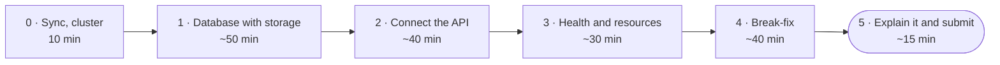

# Lab 8 · Mission: run the whole app

**Add PostgreSQL with storage, a ConfigMap, a Secret, probes and resources to your `k8s/`. Then one `apply` on a fresh cluster runs the whole app, and your todos survive a new database Pod. After that, find three faults that a teammate brought in. This brief says what must be true in your fork. Finding out how is the mission.**

DevOps (ELE1013M) · Turiba University · Session 8 · **self-study, no class** · individual work
Theory: Session 8 slides "Kubernetes II: run the whole app" (BATIS). Read them first, about 40 min

| | |
|-|-|
| **You will** | Run PostgreSQL on a PVC, give the API its settings from a ConfigMap and its password from a Secret, make the API wait for the database, add probes and resource limits, then debug three faults |
| **You hand in** | The URL of your fork on Evaluentis: `https://github.com/<you>/turiba-devops-labs` |
| **Passed when** | The gates G1–G6 (80 points), plus the quality of your write-up, PRs and commits (20 points). The grader starts a **fresh** kind cluster, runs **one** `kubectl apply -f k8s/` from your `main`, creates the Secret itself, saves a todo, deletes the database Pod and reads the todo back. An LLM reads your write-up |
| **Deadline** | **Sat 14 Nov 2026, 22:00** (Riga). A snapshot of your fork is taken at 22:05 |



---

## Tonight there is no class

> 📖 **Read first:** the Session 8 slides (about 40 minutes). Every Part below names the slides it needs.
>
> **When you're stuck, work through this order:**
> 1. the hints in this brief, one level at a time: 🔎 **Look** → 💡 **Think** → 🛠 **Fix**;
> 2. the **Troubleshooting** table at the end;
> 3. slide 14, "The debug loop, extended";
> 4. after 20 minutes: a post in BATIS with the command you ran, its **exact** output, and what you expected.
>
> Helping each other is welcome: explain, debug together on a call, share links. Copying someone's files is not.

## How this mission works

As in Missions 6 and 7, this brief tells you what must be true when you're done, and where to learn how. You learn by reading the docs, trying, reading the error, and trying again.

| Part | Typical time | Slides |
|------|-------------:|-------:|
| 0 · Sync, cluster | 10 min | 2 |
| 1 · Database with storage | 50 min | 3–8 |
| 2 · Connect the API | 40 min | 4, 5, 11 |
| 3 · Health and resources | 30 min | 9, 10, 12 |
| 4 · Break-fix | 40 min | 6, 10, 14 |
| 5 · Explain it and submit | 15 min | — |

- Do the parts **in order**. Each one needs the one before it.
- **Hints are free:** 🔎 **Look** → 💡 **Think** → 🛠 **Fix**. Open one level at a time.
- **`bash lab08-run-the-whole-app/check.sh`** does what the grader does: a throwaway cluster, one `apply`, the Secret, the rollouts, a todo, a new database Pod, the todo again. Run it whenever you like.
- **📝** marks something you write into `lab8/README.md`. **🔮** marks a prediction: write it **before** you look.
- **Always say the namespace:** `kubectl -n course …`.
- Commands are written for **bash**: on Windows, use the **Ubuntu (WSL)** terminal in `~/turiba-devops-labs`.

> ⚠️ **Six rules for this mission**
> 1. **Every change reaches `main` through a pull request in your fork**, never in the course repo.
> 2. **Use the exact names in the tables.** The grader and `break.sh` find your objects by them.
> 3. **The Secret is never a file in Git.** You make it with a command, and the grader makes its own.
> 4. **`k8s/` holds exactly the seven files from Parts 1–2.** The grader refuses anything else. Stretch work goes in `stretch/`.
> 5. **The API image is your own release, or a fallback.** Never `latest`.
> 6. **Delete your cluster when you stop for the day:** `kind delete cluster`. Your files are safe in Git.

---

## Finish line: the gates

| Gate | Points | What must be true at the snapshot |
|------|-------:|-----------------------------------|
| **G1** · The Lab 8 sync PR is merged | 5 | `lab08-run-the-whole-app/` is on your `main`, unchanged |
| **G2** · k8s/ on main: the seven files, the names, the wiring | 30 | `k8s/` has the seven files from Parts 1–2, with the names, values, probes and resources from the tables. No Secret in Git. The API image is yours (or a fallback), pinned to a tag that exists |
| **G3** · One apply on a fresh cluster: every Pod ready, a todo saved, and it survives a new database Pod | 20 | On a new kind cluster, **one** `kubectl apply -f k8s/` succeeds. After the grader creates `db-secret`, both rollouts finish within 4 minutes, `POST /api/todos` saves a todo, and after the database Pod is deleted and replaced, `GET /api/todos` still lists it. No container restarts over and over |
| **G4** · Break-fix: a merged PR with the teammate's commit and your fixes | 15 | A merged PR into `main` contains the `break.sh` commit and your own later commits that change `k8s/`. G2 passes on `main` afterwards |
| **G5** · No password or token in the repository | 5 | Checked by the grader over all branches and tags |
| **G6** · lab8/README.md: "Database with storage" and "What broke and how I found it" | 5 | Sections 1 and 4 of `lab8/README.md` show your todo surviving a new database Pod, with your own output, and name each of the three faults with the command that showed it |

The other **20 points** are for quality:

| Criterion | Points | What earns them |
|-----------|-------:|-----------------|
| Q1 | 8 | Your own output, copied, and your predictions, with any mismatch explained |
| Q2 | 6 | Your PR descriptions say what changed and how you checked it on the cluster |
| Q3 | 6 | Conventional Commit messages, one fix per commit in Part 4 |

---

## Learn from

| For | Read or watch | What to take from it |
|-----|---------------|----------------------|
| Everything | **The Session 8 slides** (BATIS) | The YAML shapes, and real output for every fault you can meet tonight |
| Part 1 | Kubernetes docs: [Secrets](https://kubernetes.io/docs/concepts/configuration/secret/), [ConfigMaps](https://kubernetes.io/docs/concepts/configuration/configmap/) | `kubectl create secret generic`; `secretKeyRef`; `envFrom` with `configMapRef` |
| Part 1 | Kubernetes docs: [Persistent Volumes](https://kubernetes.io/docs/concepts/storage/persistent-volumes/), the section "PersistentVolumeClaims" | `accessModes`, `resources.requests.storage`; how a Pod mounts a claim |
| Part 1 | [The postgres image docs](https://github.com/docker-library/docs/blob/master/postgres/README.md), sections "Environment Variables" and "PGDATA" | `POSTGRES_PASSWORD`, `POSTGRES_USER`, `POSTGRES_DB`, and why they count only on the first start |
| Part 2 | Kubernetes docs: [Init Containers](https://kubernetes.io/docs/concepts/workloads/pods/init-containers/), the example "Init containers in use" | A container that waits for a Service before the app starts |
| Part 3 | Kubernetes docs: [Liveness, Readiness and Startup Probes](https://kubernetes.io/docs/concepts/configuration/liveness-readiness-startup-probes/) (what they do), [Configure probes](https://kubernetes.io/docs/tasks/configure-pod-container/configure-liveness-readiness-startup-probes/) (the YAML) | `httpGet` and `exec` probes; what happens when each one fails |
| Part 3 | Kubernetes docs: [Resource Management for Pods and Containers](https://kubernetes.io/docs/concepts/configuration/manage-resources-containers/) | `requests` vs `limits`; CPU units (`50m`) and memory units (`64Mi`) |
| Part 4 | [Debug Pods](https://kubernetes.io/docs/tasks/debug/debug-application/debug-pods/) | The questions to ask, in order |
| Video | DevOps Directive, [Complete Kubernetes Course](https://www.youtube.com/watch?v=2T86xAtR6Fo) (2024) | Only the chapter "Built-in Kubernetes Resources": ConfigMaps, Secrets, PersistentVolumes |

---

## Part 0 · Sync and check (10 min)

**1. Bring the Lab 8 material into your fork** through a pull request, the same way as in Labs 4–7:

```bash
git switch main && git pull
git fetch upstream
git switch -c chore/sync-upstream
git merge upstream/main
git push -u origin HEAD
```

Open the PR in **your fork**, merge it with **Create a merge commit**, then run `git switch main && git pull`.

**2. Your starting point is your Mission 7 `k8s/`:** the Namespace, the Deployment `api` and the Service `api`.

- **Mission 7 doesn't work, or you never did it?** Copy the fallback and bring it in through a PR. It costs no points. Then write "Fallback Mission 7 files used: yes" at the top of your write-up.

  ```bash
  mkdir -p k8s && cp lab08-run-the-whole-app/reference/*.yaml k8s/
  ```

- **No release `0.2.0` of your own?** Use the fallback image `ghcr.io/martinsturiba/turiba-devops-labs/api:0.2.0`. It costs no points either.

**3. Your cluster:**

```bash
kind create cluster                 # skip it if `kind get clusters` already lists "kind"
kubectl config current-context      # kind-kind
kubectl apply -f k8s/               # your Mission 7 app
kubectl -n course get pods          # 3 api Pods, Running
```

**4. Start your write-up:**

```bash
mkdir -p lab8 && cp lab08-run-the-whole-app/write-up-template.md lab8/README.md
```

✅ **Checkpoint:** 3 `api` Pods are `Running`. `ls lab08-run-the-whole-app` shows `break.sh`, `check.sh`, `check.py`, `reference/` and `write-up-template.md`.

---

## Part 1 · Database with storage (50 min)

**What must be true:** PostgreSQL runs on your cluster, with its data on a PVC and its password from a Secret that is not in Git.

**The Secret** isn't a file. Make it with a command (slide 5). The Namespace must exist first:

```bash
kubectl apply -f k8s/00-namespace.yaml
kubectl -n course create secret generic db-secret --from-literal=password='<a practice password>'
```

This is a practice password for the cluster on your laptop. Don't reuse a real one, and never write it into a file in your repository.

**Four new files:**

| File | Object | Must have |
|------|--------|-----------|
| `k8s/app-config.yaml` | ConfigMap `app-config` in namespace `course` | `DB_HOST: db`, `DB_PORT: "5432"` (in quotes), `DB_USER: todo`, `DB_NAME: todo` |
| `k8s/db-pvc.yaml` | PersistentVolumeClaim `db-data` in namespace `course` | `accessModes: [ReadWriteOnce]`; `storage: 1Gi`; **no** `storageClassName` (kind's default `standard` is used) |
| `k8s/db-deployment.yaml` | Deployment `db` in namespace `course` | `replicas: 1`; `strategy: type: Recreate`; selector and Pod labels `app: db`; one container named `postgres` with the image `postgres:17-alpine` and `containerPort: 5432`; `POSTGRES_USER` and `POSTGRES_DB` set to `todo` (as values, or from the ConfigMap's `DB_USER` and `DB_NAME`); `POSTGRES_PASSWORD` from the Secret `db-secret`, key `password`; the PVC `db-data` mounted at `/var/lib/postgresql/data` |
| `k8s/db-service.yaml` | Service `db` in namespace `course` | type `ClusterIP`; selector `app: db`; `port: 5432` → `targetPort: 5432` |

- `postgres:17-alpine` is the same image as in your `compose.yaml` (Lab 4), so the data path is the same too (slide 8).
- Probes and resources come in Part 3.

🔮 **Predict** (📝 section 1, later): `kubectl -n course get pvc` right after `apply`, before the database Pod has started. Will the PVC be `Bound` or `Pending`?

<details><summary>🔎 Look</summary>

Slides 4, 5, 7 and 8 show every one of these shapes. Start from the Deployment you already have for `api`: the `db` Deployment has the same skeleton, with a different name, label, image and port. Then add `env`, `volumeMounts` and `volumes`.
</details>

<details><summary>💡 Think</summary>

- Your `compose.yaml` already says all of this. `environment:` becomes `env:`, the `.env` password becomes the Secret, and `volumes: pgdata:` becomes the PVC (slide 3).
- `POSTGRES_PASSWORD` uses `valueFrom.secretKeyRef`. It never uses `value:`.
- A volume is used in two places in a Pod: `volumes:` at the Pod level names the PVC, and `volumeMounts:` in the container says where it appears. They're linked by the volume's `name`.
- `Recreate`, so that two PostgreSQL servers never share one data folder (slide 8).
</details>

<details><summary>🛠 Fix</summary>

`k8s/app-config.yaml`:

```yaml
apiVersion: v1
kind: ConfigMap
metadata:
  name: app-config
  namespace: course
data:
  DB_HOST: db
  DB_PORT: "5432"
  DB_USER: todo
  DB_NAME: todo
```

`k8s/db-pvc.yaml`:

```yaml
apiVersion: v1
kind: PersistentVolumeClaim
metadata:
  name: db-data
  namespace: course
spec:
  accessModes: [ReadWriteOnce]
  resources:
    requests:
      storage: 1Gi
```

`k8s/db-deployment.yaml` (probes and resources come in Part 3):

```yaml
apiVersion: apps/v1
kind: Deployment
metadata:
  name: db
  namespace: course
spec:
  replicas: 1
  strategy:
    type: Recreate
  selector:
    matchLabels:
      app: db
  template:
    metadata:
      labels:
        app: db
    spec:
      containers:
        - name: postgres
          image: postgres:17-alpine
          ports:
            - containerPort: 5432
          env:
            - name: POSTGRES_USER
              valueFrom:
                configMapKeyRef: { name: app-config, key: DB_USER }
            - name: POSTGRES_DB
              valueFrom:
                configMapKeyRef: { name: app-config, key: DB_NAME }
            - name: POSTGRES_PASSWORD
              valueFrom:
                secretKeyRef: { name: db-secret, key: password }
          volumeMounts:
            - name: data
              mountPath: /var/lib/postgresql/data
      volumes:
        - name: data
          persistentVolumeClaim:
            claimName: db-data
```

`k8s/db-service.yaml`:

```yaml
apiVersion: v1
kind: Service
metadata:
  name: db
  namespace: course
spec:
  type: ClusterIP
  selector:
    app: db
  ports:
    - port: 5432
      targetPort: 5432
```

Then run `kubectl apply -f k8s/` and `kubectl -n course rollout status deployment/db`.
</details>

✅ **Checkpoint:**

- `kubectl -n course get pods,pvc` shows the `db` Pod `1/1 Running` and the PVC `db-data` as `Bound`.
- `kubectl -n course exec deployment/db -- pg_isready -h localhost -U todo -d todo` prints `localhost:5432 - accepting connections`.
- The four files reach `main` through a PR.

---

## Part 2 · Connect the API (40 min)

**What must be true:** the API reads its settings from the ConfigMap and its password from the Secret, waits for the database before it starts, and saves todos that survive a new database Pod.

**Change `k8s/api-deployment.yaml`.** Keep everything from Mission 7, and add:

| Where | Must have |
|-------|-----------|
| The container `api` | `envFrom` with `configMapRef` `app-config`, so that `DB_HOST`, `DB_PORT`, `DB_USER` and `DB_NAME` come from it; `DB_PASSWORD` from the Secret `db-secret`, key `password` |
| The Pod (`spec.template.spec`) | An init container named `wait-for-db`, with the image `postgres:17-alpine`, that loops until `pg_isready -h "$DB_HOST" -p "$DB_PORT"` succeeds. It gets `DB_HOST` and `DB_PORT` from the same ConfigMap |

The variable names come from `api/db.js`. They are the same ones your `compose.yaml` sets.

🔮 **Predict** (📝 section 2): you run `kubectl -n course get secret db-secret -o yaml`. Will you see your password?

<details><summary>🔎 Look</summary>

Slide 4 shows `envFrom`, slide 5 `secretKeyRef`, and slide 11 the whole init container. The Kubernetes page "Init Containers" has a complete example with `until …; do …; sleep 2; done`.
</details>

<details><summary>💡 Think</summary>

- Kubernetes has no `depends_on`. Without the init container, the API can start before PostgreSQL. It then never creates its table and answers `500` for ever, while every Pod looks fine (slide 11).
- `initContainers:` sits next to `containers:`, at the same level, not inside it.
- The init container needs `DB_HOST` and `DB_PORT` too, so give it the same `envFrom`.
</details>

<details><summary>🛠 Fix</summary>

`k8s/api-deployment.yaml` (your image stays as it was):

```yaml
apiVersion: apps/v1
kind: Deployment
metadata:
  name: api
  namespace: course
spec:
  replicas: 3
  selector:
    matchLabels:
      app: api
  template:
    metadata:
      labels:
        app: api
    spec:
      initContainers:
        - name: wait-for-db
          image: postgres:17-alpine
          command: ["sh", "-c", "until pg_isready -h \"$DB_HOST\" -p \"$DB_PORT\"; do echo waiting for the database; sleep 2; done"]
          envFrom:
            - configMapRef: { name: app-config }
      containers:
        - name: api
          image: ghcr.io/<you>/turiba-devops-labs/api:0.2.0
          ports:
            - containerPort: 5000
          envFrom:
            - configMapRef: { name: app-config }
          env:
            - name: DB_PASSWORD
              valueFrom:
                secretKeyRef: { name: db-secret, key: password }
```
</details>

**Then test the whole app, and the storage:**

```bash
kubectl apply -f k8s/
kubectl -n course rollout status deployment/api
kubectl -n course port-forward service/api 8080:80          # in a second terminal, leave it running
curl -s -X POST -H 'Content-Type: application/json' -d '{"title":"survive a restart"}' localhost:8080/api/todos
curl -s localhost:8080/api/todos
```

🔮 **Predict** (📝 section 1): you delete the database Pod. Will your todo still be there afterwards?

Delete the `db` Pod (`kubectl -n course get pods -l app=db` gives its name), wait until the new one is `1/1`, and run `curl -s localhost:8080/api/todos` again. The first request after a new database Pod may answer `500` once, while the API reconnects. Try again.

✅ **Checkpoint:**

- `POST` answers with a todo and an `id`, and `GET` lists it.
- After the database Pod is replaced (a new name, a few seconds old), `GET` still lists your todo.
- `kubectl -n course logs deployment/api -c wait-for-db` ends with `db:5432 - accepting connections`.
- The change reaches `main` through a PR.

📝 Sections 1 and 2: the output, your predictions, and what you saw in the Secret, **in words only. Don't paste the value**, not even the base64 form.

---

## Part 3 · Health and resources (30 min)

**What must be true:** both Deployments have probes and resources, and one `apply` on a fresh cluster brings up the whole app.

| Container | `readinessProbe` and `livenessProbe` | `resources` |
|-----------|--------------------------------------|-------------|
| `api` | `httpGet` on `path: /healthz`, `port: 5000` | `requests` with `cpu` and `memory`; `limits` with `memory` |
| `postgres` | `exec` with `pg_isready -h localhost -U todo -d todo` | `requests` with `cpu` and `memory`; `limits` with `memory` |

- **No `/healthz` in your image?** Then you skipped Lab 2 step 2.4. Use `path: /` instead: it answers 200 without a database. The fallback image has `/healthz`.
- Give the liveness probes an `initialDelaySeconds` (10 for the API, 30 for PostgreSQL). A database needs time on its first start.
- The values on slide 12 worked in the test cluster.

**An experiment, on your working copy only.** Point the API's **liveness** probe at `/nope`, then run `kubectl apply -f k8s/`.

🔮 **Predict** (📝 section 3): will those Pods get traffic? Will they be restarted?

Watch `kubectl -n course get pods -l app=api` for about a minute, and `describe` one of the new Pods. Then make Git and the cluster agree again: `git restore k8s/ && kubectl apply -f k8s/`.

<details><summary>🔎 Look</summary>

Slide 9 has both probes for both containers, and slide 12 has `resources`. The Kubernetes task page "Configure Liveness, Readiness and Startup Probes" shows `httpGet` and `exec` probes.
</details>

<details><summary>💡 Think</summary>

- Readiness answers "can this Pod take traffic?" Liveness answers "is it stuck for good?" A failing liveness probe restarts the container. A failing readiness probe only takes the Pod out of the Service (slides 9–10).
- `-h localhost` makes `pg_isready` check over TCP. On its first start, PostgreSQL runs a temporary server that doesn't listen on TCP (slide 9).
- Over the memory limit, the container is killed. 128Mi is plenty for the API. 16Mi is not (slide 12).
</details>

<details><summary>🛠 Fix</summary>

In `k8s/api-deployment.yaml`, under the container `api`:

```yaml
          readinessProbe:
            httpGet: { path: /healthz, port: 5000 }
            periodSeconds: 5
          livenessProbe:
            httpGet: { path: /healthz, port: 5000 }
            initialDelaySeconds: 10
            periodSeconds: 10
          resources:
            requests: { cpu: 50m, memory: 64Mi }
            limits: { cpu: 500m, memory: 128Mi }
```

In `k8s/db-deployment.yaml`, under the container `postgres`:

```yaml
          readinessProbe:
            exec:
              command: [pg_isready, -h, localhost, -U, todo, -d, todo]
            periodSeconds: 5
          livenessProbe:
            exec:
              command: [pg_isready, -h, localhost, -U, todo, -d, todo]
            initialDelaySeconds: 30
            periodSeconds: 10
          resources:
            requests: { cpu: 100m, memory: 128Mi }
            limits: { memory: 256Mi }
```
</details>

**Then the test that the grader runs.** Start from nothing, with one `apply` and the Secret:

```bash
kind delete cluster && kind create cluster
kubectl apply -f k8s/
kubectl -n course create secret generic db-secret --from-literal=password='<a practice password>'
kubectl -n course get pods -w        # Init:0/1 and CreateContainerConfigError first, then Running. Ctrl+C stops it
```

The Pods wait while the Secret is missing, then start by themselves (slide 6).

✅ **Checkpoint:**

- On the fresh cluster, all 4 Pods are `1/1 Running`, and `RESTARTS` stays at `0`.
- `GET /api/todos` answers through the port-forward.
- The change reaches `main` through a PR.
- `bash lab08-run-the-whole-app/check.sh` shows ✔ for G2 and G3.

---

## Part 4 · Break-fix (40 min)

A teammate "tidied up" the configuration and the probes. `break.sh` brings their commit into your clone on a new branch:

```bash
git switch main && git pull
bash lab08-run-the-whole-app/break.sh
git push -u origin HEAD
```

Open a PR into `main` in **your fork**. No check runs on `k8s/`: this time **you** are the check.

🔮 **Predict** (📝 section 4): you apply this branch to the cluster where `main` already runs. What goes wrong first?

**What must be true:** you apply the branch (`kubectl apply -f k8s/`) and find **all three** faults with the debug loop (slide 14). You fix each one **in its own commit** on the same branch, apply again, push, and merge when every Pod is ready and `GET /api/todos` answers through the port-forward.

<details><summary>🔎 Look</summary>

`kubectl -n course get pods`, then `describe` every Pod that isn't `1/1 Running`, and read its Events. For a Pod stuck in `Init:0/1`, read the init container's log: `kubectl -n course logs <pod> -c wait-for-db`. `get pods` doesn't always show the real reason. `describe` does (slide 14).
</details>

<details><summary>💡 Think</summary>

- The PR's **Files changed** tab shows every line the teammate touched. For each one, ask: does this name still match what it points to?
- Faults show up **one at a time.** The second one only appears after the first is fixed, because a Pod gets stuck at the first problem.
- **Fixed the ConfigMap, but the Pod still waits?** A running container keeps the variables it started with (slide 4). Restart it: `kubectl -n course rollout restart deployment/api`.
- While the new Pods fail, the old Pods from `main` keep serving. That's the rolling update protecting you (S7).
</details>

<details><summary>🛠 Fix</summary>

1. In `k8s/app-config.yaml`, `DB_HOST` became `database`. No Service has that name, so the init container waits for ever (`Init:0/1`, and its log says `database:5432 - no response`). Make it `db` again, apply, then `kubectl -n course rollout restart deployment/api`.
2. In `k8s/api-deployment.yaml`, the Secret key became `pasword`. The container can't be created (`describe`: `couldn't find key pasword in Secret course/db-secret`). Make it `password` again.
3. In `k8s/api-deployment.yaml`, the readiness probe's port became `5001`. Nothing listens there, so the Pod stays `0/1 Running` (`describe`: `Readiness probe failed: … :5001/healthz … connection refused`). Make it `5000` again.
</details>

✅ **Checkpoint:**

- The PR has the teammate's commit plus your three fix commits.
- After the merge, `kubectl apply -f k8s/` from `main` gives every Pod `1/1`.
- `GET /api/todos` answers through the port-forward.
- `check.sh` shows ✔ for G4.

📝 Section 4, **"What broke and how I found it":** for each fault, what you saw, the command and the line of output that showed it, and your fix commit.

---

## Part 5 · Explain it and submit (15 min)

1. Finish `lab8/README.md`: every `____` replaced. Bring it in through a PR.
2. Run the self-check:

   ```bash
   bash lab08-run-the-whole-app/check.sh
   ```

   - **What it does:** it makes a second kind cluster, `lab8-check`, for 2–4 minutes. It applies your `k8s/` from `main` once, creates its own Secret, waits for the rollouts, saves a todo, replaces the database Pod and reads the todo back. Then it deletes that cluster. Your own cluster and your kubectl context are left alone.
   - **Low on memory?** Run `kind delete cluster` for your own cluster first.
   - **The token:** it finds one by itself if `gh` is logged in. Otherwise it asks, and hides what you paste.
3. Submit `https://github.com/<you>/turiba-devops-labs` on Evaluentis before **Sat 14 Nov, 22:00**.

✅ **Checkpoint:** `check.sh` shows ✔ for G1, G2, G3, G4 and G6. G5 is checked by the grader only.

---

## Troubleshooting

| You see | Why | Fix |
|---------|-----|-----|
| `CreateContainerConfigError`, or `PodInitializing` that never ends | A Secret, ConfigMap or key that doesn't exist. `describe` names it: `secret "db-secret" not found` or `couldn't find key …` | Create the Secret (Part 1), or correct the name or key. The Pod starts by itself afterwards |
| `kubectl create secret …`: `namespaces "course" not found` | The Namespace doesn't exist yet | `kubectl apply -f k8s/00-namespace.yaml` first |
| `apply` of `app-config.yaml` fails with `cannot unmarshal number into Go struct field ConfigMap.data of type string` | Every value in a ConfigMap is a string | `DB_PORT: "5432"`, with quotes |
| `Init:0/1` for minutes | The init container still waits: the database isn't ready, or `DB_HOST` is wrong | `kubectl -n course logs <pod> -c wait-for-db`; check the `db` Pod and `DB_HOST: db` |
| Fixed `DB_HOST`, but the Pod still says `Init:0/1` | A running container keeps its old variables (slide 4) | `kubectl -n course rollout restart deployment/api` |
| Every API Pod `1/1`, `/api/todos` answers `{"error":"internal error"}`, and the log says `relation "todos" does not exist` | The API started before PostgreSQL and never made its table (slide 11) | Now: `kubectl -n course rollout restart deployment/api`. For good: the init container (Part 2) |
| The same, and the log says `getaddrinfo ENOTFOUND …` | `DB_HOST` names a Service that doesn't exist | `DB_HOST: db` |
| The same, and the log says `password authentication failed for user "todo"` | The Secret was changed after the database was created. PostgreSQL reads the password only on its first start (slide 8) | Put the old password back. Or, if the data doesn't matter: `kubectl -n course delete deployment db && kubectl -n course delete pvc db-data && kubectl apply -f k8s/` |
| `db` Pod `CrashLoopBackOff`, and its log says `Database is uninitialized and superuser password is not specified` | `POSTGRES_PASSWORD` is missing or empty | Take it from the Secret `db-secret`, key `password` (Part 1) |
| PVC `Pending`, with `ProvisioningFailed … storageclass … not found` in `describe pvc` | A `storageClassName` that kind doesn't have | Delete the `storageClassName` line |
| PVC `Pending` with no error, before the database Pod exists | Normal: kind binds the PVC only when a Pod uses it (`WaitForFirstConsumer`, slide 7) | Nothing. It turns `Bound` when the `db` Pod starts |
| `0/1 Running` and `Readiness probe failed` | The readiness probe asks the wrong port or path | `port: 5000`, `path: /healthz` (or `/`) |
| `RESTARTS` keeps growing, `Liveness probe failed: HTTP probe failed with statuscode: 404` | The liveness probe asks a path that doesn't exist | `path: /healthz`. No `/healthz` in your image? Use `/` |
| `CrashLoopBackOff`, and `describe` shows `Last State: Terminated, Reason: OOMKilled` | The memory limit is too small | `limits: { memory: 128Mi }` for the API |
| `Pending`, and `describe` says `Insufficient cpu` | The requests are bigger than your node | Requests like slide 12: `50m` and `100m` |
| `kubectl` shows objects you don't know, or none at all | It's talking to another cluster, or another namespace | `kubectl config current-context` must say `kind-kind`; add `-n course` |
| The first `GET` after a new database Pod answers `500`, and the next one works | The API's old connection broke and it reconnects | Nothing. Ask again |
| `port-forward`: `address already in use` | Another port-forward still runs | Stop it with Ctrl+C, or use `8081:80` |
| `break.sh` says `✘ …` | It refuses rather than guess | Do what the line says. It changed nothing |
| `check.sh`: `kind could not create lab8-check` | Not enough memory, or Docker isn't running | Delete your own cluster first (`kind delete cluster`); start Rancher Desktop or Docker Desktop |
| `check.sh` was stopped half-way | — | `kind delete cluster --name lab8-check` |

---

## Stretch (for fast finishers)

Stretch files go in a folder `stretch/`, **not** in `k8s/`: the grader applies only `k8s/`. Add a section "Stretch" to the end of `lab8/README.md`. It gives no points and costs none.

| Goal | Proves |
|------|--------|
| **Traffic in with Gateway API.** Install [cloud-provider-kind](https://github.com/kubernetes-sigs/cloud-provider-kind) (it runs in a second terminal and needs `sudo`), write a Gateway and an HTTPRoute that send `/` to the Service `api`, and `curl` through the Gateway's address | Slide 13: one entry point instead of `port-forward`. Start at [kind: Ingress](https://kind.sigs.k8s.io/docs/user/ingress/) and [Gateway API](https://kubernetes.io/docs/concepts/services-networking/gateway/) |
| Add a `startupProbe` to PostgreSQL and drop the liveness probe's `initialDelaySeconds` | Slide 9: the third probe |
| Write PostgreSQL as a **StatefulSet** with `volumeClaimTemplates` in `stretch/`, and compare it with your Deployment | Slide 8: what production uses |

---

## Command summary

```bash
kubectl -n course create secret generic db-secret --from-literal=password='…'   # never a file in Git
kubectl apply -f k8s/                                         # the desired state, from your files
kubectl -n course get pods,pvc                                # what is there
kubectl -n course describe pod <name>                         # read the Events: the real reason
kubectl -n course logs <pod> -c wait-for-db                   # the init container
kubectl -n course logs deployment/api -c api                  # what the API said
kubectl -n course rollout restart deployment/api              # new Pods, new variables
kubectl -n course port-forward service/api 8080:80            # then: curl -s localhost:8080/api/todos
bash lab08-run-the-whole-app/break.sh                         # Part 4
bash lab08-run-the-whole-app/check.sh                         # what the grader will see
```
